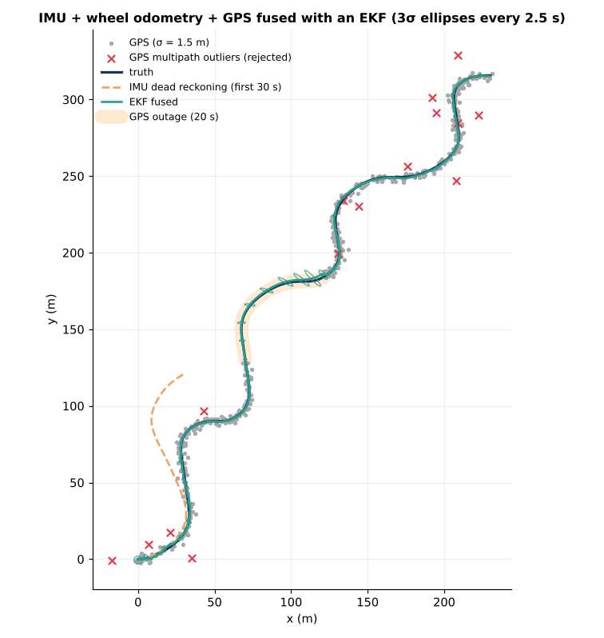
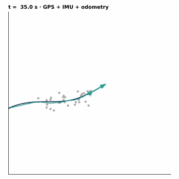
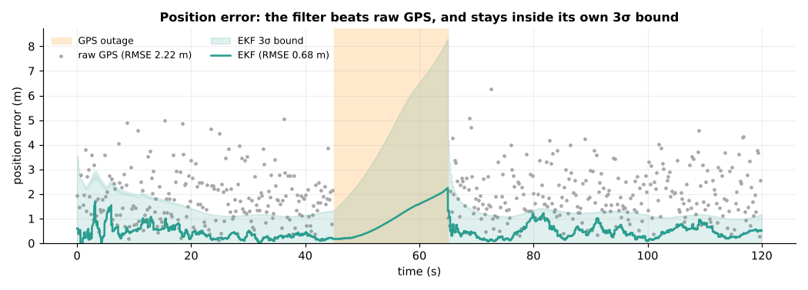
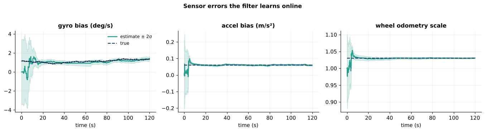
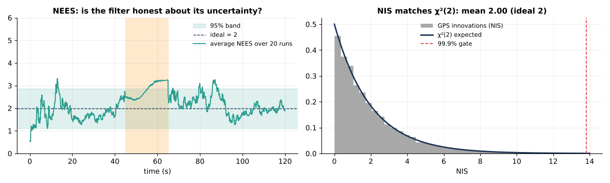

# 10 · Sensor fusion: IMU + wheel odometry + GPS with an EKF

An **extended Kalman filter** that fuses a cheap, drifting **IMU** (100 Hz), slipping **wheel odometry** (20 Hz) and noisy **GPS** (5 Hz). The GPS has multipath jumps and a 20-second outage. The filter learns the sensors' own errors online and is **checked for statistical consistency**, not just accuracy.

<p>


</p>

| | position RMSE |
|---|---|
| raw GPS | 2.22 m |
| IMU dead reckoning | drifts **376 m** in 2 minutes |
| **EKF (IMU + odometry + GPS)** | **0.68 m** |



During the GPS outage (shaded), error grows to about 2 m while the filter's **3σ bound grows faster**, so the filter knows it's uncertain. When GPS returns, both collapse.

## It learns the sensors' mistakes

The state carries the **gyro bias**, **accelerometer bias** and the **wheel scale factor** (a 3% tyre-radius error), and all three converge within about 15 s:



## Is the filter honest? (consistency)

Accuracy alone can hide an overconfident filter, so it's checked statistically over 20 Monte Carlo runs:



- **NIS** (normalized innovation squared) of GPS updates follows χ²(2) almost exactly: **mean 2.00** against an ideal of 2.
- **NEES** (normalized estimation error squared) averages **2.14** against an ideal of 2, and sits inside the 95% band 87% of the time. It drifts slightly above the band late in the outage: linearization makes the EKF a little overconfident when heading uncertainty grows. That's a known EKF limitation, and a UKF or error-state filter is the next step.

## Outlier rejection

Each GPS fix is gated on its Mahalanobis distance (χ²₂ at 99.9%). Over 20 runs it **caught 300/300 multipath outliers** and rejected only 10 of about 9,700 good fixes, which is the 0.1% a 99.9% gate should cost.

## The model

State `x = [px, py, θ, v, b_g, b_a, k_odo]`

| step | equation | rate |
|---|---|---|
| predict (IMU) | θ ← θ + (ω_gyro − b_g)Δt, v ← v + (a − b_a)Δt, p ← p + v[cos θ, sin θ]Δt | 100 Hz |
| odometry update | z = k_odo · v | 20 Hz |
| GPS update | z = [px, py], χ² gated | 5 Hz |

The analytic Jacobian is verified against finite differences in the tests, and the covariance update uses the **Joseph form**, so P stays symmetric positive-definite.

**What I found along the way:** wheel odometry barely helps during the outage on its own, because the drift there is in **heading**, which wheel speed can't see. It does help once accelerometer bias is modelled (RMSE 0.98 → 0.89 m over 10 seeds). Fixing heading drift properly needs a magnetometer or visual odometry.

## Tests

`pytest` runs 11 tests (~12 s): Jacobian vs finite differences · simulator sanity · EKF beats GPS by 2× or more and dead reckoning by 50× or more · biases and wheel scale learned · outlier gating (100% recall, false-reject rate under 0.5%) · gating improves RMSE · uncertainty grows in the outage and collapses after · odometry helps on average · **NEES and NIS consistency** · P stays symmetric positive-definite.

```bash
pip install -e ".[dev]"
pytest
python -m fusion.viz       # regenerates every figure and the GIF in docs/
```

## What I learned

Kalman filtering · EKF linearization · bias and scale-factor estimation · Mahalanobis gating · NEES/NIS consistency testing · why heading is the hard part of navigation
